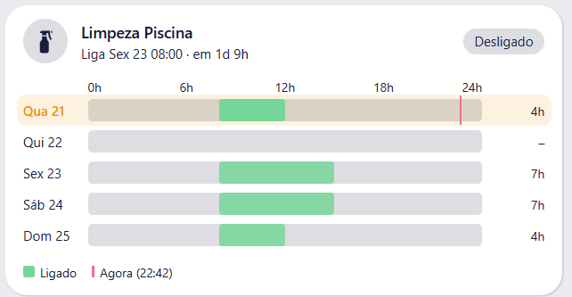
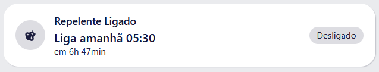
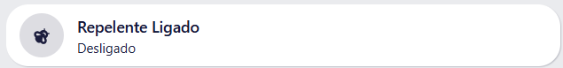

# Schedule Timeline Card

[](https://hacs.xyz)
[](https://github.com/andregoncalvespires/schedule-timeline-card/actions/workflows/validate.yml)
[](LICENSE)

A Lovelace card for Home Assistant [`schedule`](https://www.home-assistant.io/integrations/schedule/) entities.
The default entity card only tells you whether a schedule is on or off. This card also shows **when** it runs.

Three display modes:

| Mode | What it shows |
| --- | --- |
| `simple` | A clean on/off indicator with your own icon. |
| `next` | The next activation or deactivation, with a countdown ("Turns off at 20:00, in 1h 00min"). |
| `calendar` | A 24h timeline per day, with the configured on-periods painted in. Today comes first and is highlighted, with a marker for the current time. |

## Screenshots

The images follow your GitHub theme (light or dark).

**Calendar mode**

<picture>
  <source media="(prefers-color-scheme: dark)" srcset="images/calendar-dark.png">
  
</picture>

**Next event mode**

<picture>
  <source media="(prefers-color-scheme: dark)" srcset="images/next-dark.png">
  
</picture>

**Simple mode**

<picture>
  <source media="(prefers-color-scheme: dark)" srcset="images/simple-dark.png">
  
</picture>

## Features

- Custom icons for the on and off states (`icon`, `icon_off`), falling back to the entity icon.
- Calendar view for 1 to 7 days, starting with the current weekday.
- Optional visible hour window (`start_hour`, `end_hour`), for example 06:00 to 22:00.
- Tooltips on each block with start, end, duration and the interval `data`, if any.
- Optional total of on-hours per day.
- Uses the time zone configured in Home Assistant for the "now" marker.
- Uses your theme colors by default. Colors can be overridden.
- Visual editor, so no YAML is required.
- Portuguese and English texts, chosen from your Home Assistant language.

## Installation

### HACS (custom repository)

1. Open HACS and go to the menu in the top right, then **Custom repositories**.
2. Add `https://github.com/andregoncalvespires/schedule-timeline-card` with the category **Dashboard**.
3. Search for **Schedule Timeline Card**, install it, and reload your browser.

### Manual

1. Download `schedule-timeline-card.js` from the [latest release](https://github.com/andregoncalvespires/schedule-timeline-card/releases/latest).
2. Copy it to `/config/www/schedule-timeline-card.js`.
3. Go to **Settings > Dashboards > Resources** and add `/local/schedule-timeline-card.js` as a **JavaScript module**.
4. Hard refresh the browser (Ctrl+F5).

## Usage

```yaml
type: custom:schedule-timeline-card
entity: schedule.irrigation
mode: calendar
icon: mdi:sprinkler
icon_off: mdi:sprinkler-variant
days: 5
```

### Simple

```yaml
type: custom:schedule-timeline-card
entity: schedule.irrigation
mode: simple
icon: mdi:sprinkler
```

### Next event

```yaml
type: custom:schedule-timeline-card
entity: schedule.irrigation
mode: next
```

### Calendar with a limited hour window and totals

```yaml
type: custom:schedule-timeline-card
entity: schedule.pool_pump
mode: calendar
days: 7
start_hour: 6
end_hour: 22
show_total: true
on_color: "#2196f3"
```

## Options

| Option | Type | Default | Description |
| --- | --- | --- | --- |
| `entity` | string | **required** | A `schedule.*` entity. |
| `name` | string | entity name | Overrides the displayed name. |
| `mode` | string | `simple` | `simple`, `next` or `calendar`. |
| `icon` | string | entity icon | Icon used when the schedule is on. Also used when off if `icon_off` is not set. |
| `icon_off` | string | `icon` | Icon used when the schedule is off. |
| `show_icon` | boolean | `true` | Show or hide the icon. |
| `days` | number | `5` | Number of days in `calendar` mode (1 to 7). The first row is today. |
| `start_hour` | number | `0` | First hour shown in the timeline (0 to 23). |
| `end_hour` | number | `24` | Last hour shown in the timeline (1 to 24). |
| `show_next` | boolean | `true` | Show the next event under the name in `calendar` mode. |
| `show_now_marker` | boolean | `true` | Show the current time marker on today's row. |
| `show_total` | boolean | `false` | Show the total on-time of each day. |
| `show_legend` | boolean | `true` | Show the legend under the timeline. |
| `on_color` | string | `var(--success-color)` | Any CSS color for the on-periods. |
| `now_color` | string | `var(--error-color)` | Any CSS color for the current time marker. |
| `tap_action` | string | `more-info` | `more-info` or `none`. |

## How it works

- The on/off state and the `next_event` attribute come from the entity itself.
- The configured periods are read with the Home Assistant WebSocket command `schedule/list`, which any logged-in frontend user can call.
- If `next_event` is missing, the card computes the next change from the configured periods.
- The list is refreshed when the entity changes and every 5 minutes.

## Limitations

- Schedules defined in YAML may not be returned by `schedule/list`. In that case `simple` and `next` modes keep working, and `calendar` mode shows a notice. Schedules created in the UI (helpers) are fully supported.
- Periods in Home Assistant schedules end at 24:00 at most, so a period that spans midnight appears as two blocks, one at the end of a day and one at the start of the next.

## Troubleshooting

- **The card is not found**: check that the resource was added as a *JavaScript module* and hard refresh the browser.
- **Old version after an update**: clear the browser cache or add a version suffix to the resource URL, for example `/local/schedule-timeline-card.js?v=2`.
- **Weird characters in labels**: make sure you are running version 1.0.1 or newer.

## Versions

Tags and releases are created automatically by the `Release` workflow (`.github/workflows/release.yml`).

The version lives in a single place: the `CARD_VERSION` constant at the top of `schedule-timeline-card.js`.

To publish a new version:

1. Bump `CARD_VERSION` in `schedule-timeline-card.js` (for example from `1.0.1` to `1.0.2`).
2. Commit and push to `main`.

The `Release` workflow runs only after the `Validate` workflow (HACS validation and syntax check) has finished successfully on `main`, so a release is always created after the validation has passed. It reads the version and checks whether the release `v<version>` already exists. If it does not, it creates the tag and the release, attaches the card file and generates the release notes from the commits. If it already exists, nothing happens, so the workflow is safe to run more than once. Pushes that do not change the version simply end with "already exists".

The workflow can also be started manually from the **Actions** tab (**Run workflow**). This is useful for the very first release, or to retry after a failure.

Repository setting required: **Settings > Actions > General > Workflow permissions > Read and write permissions**.

## Contributing

Issues and pull requests are welcome.

## License

[MIT](LICENSE)
